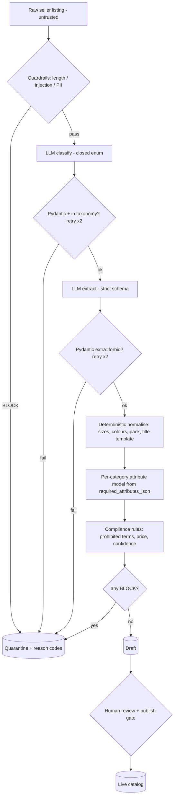

# Marketplace Catalog Ingestion Engine

AI-powered ingestion pipeline for third-party marketplace listings: cleans messy titles and variations, maps items to the canonical taxonomy, extracts and validates required attributes, enforces **deterministic** compliance rules, and routes each listing to the **Draft Catalog** (human approval → Live Catalog) or **Quarantine** (with reason codes). Includes a Streamlit operations UI and a FastAPI **Catalog Inspection API**.

> ⚠️ All data in this repo is **SYNTHETIC** (fictional suppliers, brands and listings).

**Core principle: the LLM proposes, Python decides.** The model only (a) picks a category from a closed list and (b) extracts facts into a strict schema. Every output is validated with Pydantic and retried with the validation error; all policy (required attributes, prohibited terms, price, PII, injection, confidence, routing, publishing) is plain Python. The LLM is never asked "is this compliant?".

## Quick start
```bash
python -m venv .venv
.venv\Scripts\activate            # Windows  (source .venv/bin/activate on macOS/Linux)
pip install -r requirements.txt
copy .env.example .env            # optional: set LLM_PROVIDER=anthropic + ANTHROPIC_API_KEY
python -m app.data.seed_synthetic --reset

streamlit run app/main.py                         # UI      -> http://localhost:8501
python -m uvicorn app.api.server:app --port 8000  # API     -> http://localhost:8000/docs
pytest -q                                         # tests
python -m evals.run                               # evals   -> evals/results/latest.md
python scripts/make_docx.py && python scripts/make_pptx.py
```
Default provider is `mock` (deterministic, offline; it deliberately returns malformed JSON on ~20% of first attempts to exercise the retry path). With `LLM_PROVIDER=anthropic` the app uses Claude via forced tool-use (`claude-sonnet-5-5` by default, set in `config.yaml` / `LLM_MODEL`). If the real provider can't start, it falls back to mock and records that in the run snapshot.

## Pipeline

More diagrams: [docs/architecture.md](docs/architecture.md) (system, data flow, sequence) and [docs/data_model.md](docs/data_model.md) (ERD, reason codes).

Example: `Men's Dry-Fit Athletic Gym Shorts w/ Pockets Pack of 2 (Black/Navy, L) - Running Workout` (size tag `Lrg`, colour tag `Blk/Nvy`)
→ category `APP-SHORTS-M`, title `Men's Running Shorts, Dry-Fit, Pockets (Pack of 2)`, size `[L]`, colours `[Black, Navy]`, variations `ATX-1001-BLAC-L`, `ATX-1001-NAVY-L` → **DRAFT**.

## Catalog Inspection API
| Method | Path | Purpose |
|---|---|---|
| GET | `/health` | status + active LLM provider/model |
| GET | `/categories?leaf_only=` | taxonomy with required attributes & prohibited keywords |
| GET | `/listings?status=&reason=&category_id=&limit=` | processed listings with reason codes |
| GET | `/listings/{id}` | raw feed vs normalised listing, attributes, variations, violations, LLM raw output, audit |
| GET | `/quarantine?reason=` | quarantined listings by reason code |
| GET | `/catalog` | live (published) catalog |
| GET | `/feeds/{feed_id}` | raw supplier row |
| GET | `/metrics` | KPIs, quarantine reasons, ops metrics, latest eval |
| GET | `/runs` | batch run history |
| POST | `/listings/validate` | push one raw listing through the pipeline (lands in draft/quarantine, never live) |
Every response carries an `X-Request-ID` header.

## Project layout
```
app/
  main.py, pages/, ui/        Streamlit UI (built in a parallel session)
  api/server.py               FastAPI Catalog Inspection API
  services/                   workflow, classifier, extractor, structured (validate+retry), llm,
                              normalize, rules, guardrails, analytics, diagnostics, audit
  models/schemas.py           Pydantic I/O + dynamic per-category attribute model
  data/db.py, seed_synthetic.py
  observability/logging.py    JSON logs, request_id, duration, tokens
evals/ golden.jsonl run.py results/
tests/                        pytest
docs/                         architecture, data model, scope (.md/.docx), estimates & risks (.md/.docx), presentation.pptx
config.yaml  .env.example  requirements.txt
```

## Results (measured)
- **pytest:** 42 passed (normalisers, schema strictness, rules, guardrails, workflow, retry, FK enforcement, review gate, API).
- **Evals (mock provider):** 26/26 cases passed. Routing 26/26, category 15/15, compliance recall 15/15, attributes 13/13, title hygiene 7/7, injection short-circuit 2/2. See [evals/results/latest.md](evals/results/latest.md).
- **Seed batch (40 listings, mock):** 21 DRAFT, 19 QUARANTINED, 0 errors, ~1 s.

## Guardrails & governance
- Input limits, prompt-injection patterns (block before any LLM call), PII detection; seller text is delimited as `<untrusted_listing>` with angle brackets neutralised.
- Structured outputs: closed category enum, `extra="forbid"`, bounded retries with error feedback, quarantine on failure.
- Human-in-the-loop: only DRAFT listings can be approved; publish gate re-checks; quarantined listings can only be rejected.
- Audit trail (`audit_log`): pipeline routing, batch runs, human decisions with actor, model, request_id.
- Config: `config.yaml` + per-run snapshot (`pipeline_runs.config_snapshot_json`, `logs/run_snapshots/`).
- Observability: `logs/app.jsonl` (JSON; PII/secrets masked) + `request_log` table → Diagnostics page.
- Data register: see [docs/scope.md §7](docs/scope.md).

## Assumptions & limitations
- Starter DB not supplied, so it was recreated with the specified schema (+ pipeline tables) and synthetic data.
- The mock provider's heuristics were written alongside the golden set, so the 100% eval proves the deterministic layer and plumbing, **not** real-LLM accuracy. Run `python -m evals.run --provider anthropic` with a key to measure that.
- Keyword and injection detection are pattern-based (obfuscated terms can slip past the screen, but the LLM still has no authority to publish).
- No reviewer authentication; SQLite is for the prototype only.
