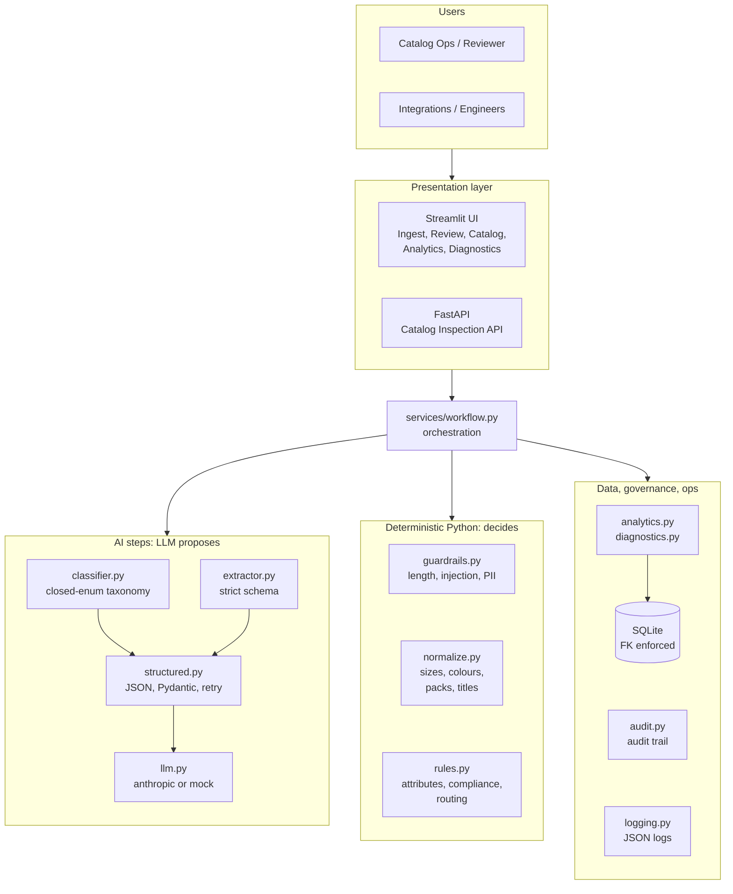
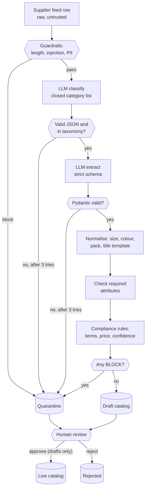
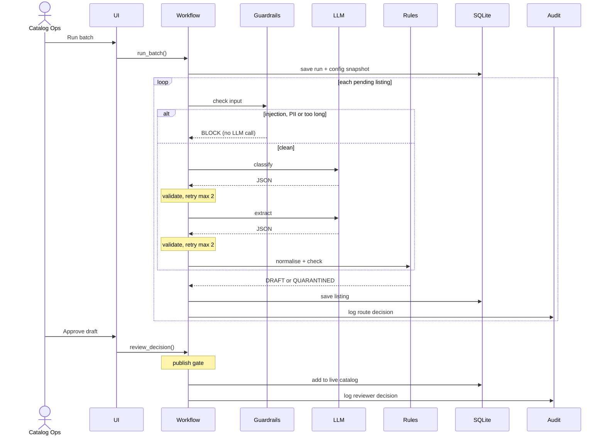

# Architecture

## Design principle
**The LLM proposes; Python disposes.** The model is used only where language understanding is needed (picking a category from a closed list, extracting facts from messy text). Every output is parsed and validated with Pydantic, retried with the validation error on failure, and then **all policy decisions** (required attributes, prohibited terms, price, PII, injection, confidence threshold, routing, publish gate) are made by deterministic Python. The LLM is never asked "is this compliant?".

## 1. System architecture

## 2. Data flow

## 3. Process sequence

## Key decisions
| Decision | Why |
|---|---|
| Classify first, then extract with the category's attribute spec | Extraction prompt asks only for the attributes that category needs; fewer hallucinated fields. |
| Two validation layers (structural vs semantic) | Structural failure = model problem -> retry. Semantic failure (missing size) = supplier data problem -> quarantine with reason code, no wasted retries. |
| Dynamic Pydantic model from `required_attributes_json` | Taxonomy owners change requirements in data, not code. |
| Canonical title built from a template, not LLM free text | Titles are consistent and can't carry injected or prohibited text from the model. |
| Guardrail BLOCK short-circuits the LLM | Injection attempts never reach the model; saves tokens. |
| Humans cannot approve quarantined listings | Compliance is a hard gate; reviewers can only reject or ask the supplier to fix. |
| `mock` provider default | Tests/evals/demos run offline and deterministically; the mock injects malformed JSON to exercise the retry path. |
| SQLite + FastAPI + Streamlit | Simplest stack meeting the requirements; same service layer serves UI and API. |
