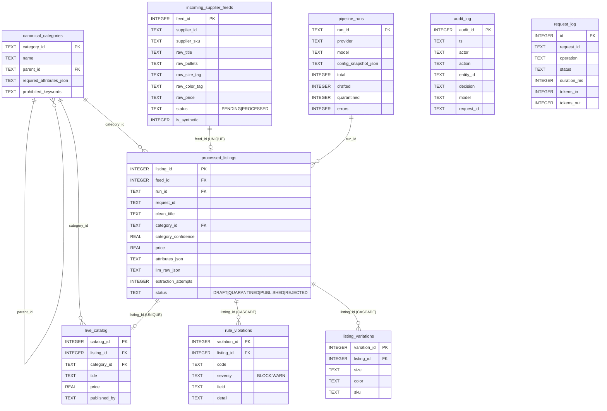

# Data model

SQLite with `PRAGMA foreign_keys = ON` on every connection (tested: inserting a violation for a non-existent listing, or a listing with an unknown category, raises `IntegrityError`). Every write passes through Pydantic first. CHECK constraints guard status enums, confidence range, positive live price.



## `required_attributes_json` format
```json
[{"name": "size", "type": "enum_list", "allowed": ["XS","S","M","L","XL","XXL","3XL"]},
 {"name": "colors", "type": "list"},
 {"name": "gender", "type": "enum", "allowed": ["Men"]},
 {"name": "material", "type": "str", "required": false}]
```
Types: `str`, `int` (min/max), `enum`, `enum_list`, `list`. Validated by `AttributeSpec`, compiled into a per-category Pydantic model by `build_attribute_model()`.

## Reason codes
| Code | Severity | Source |
|---|---|---|
| PROMPT_INJECTION_DETECTED | BLOCK | guardrails |
| PII_IN_LISTING | BLOCK | guardrails |
| INPUT_TOO_LONG | BLOCK | guardrails |
| CLASSIFICATION_INVALID / EXTRACTION_INVALID | BLOCK | schema validation after retries |
| LOW_CONFIDENCE | BLOCK | rules (threshold 0.70) |
| PROHIBITED_KEYWORD | BLOCK | rules (global + category list, word boundary) |
| MISSING_REQUIRED_ATTR / INVALID_ATTR_VALUE | BLOCK | dynamic attribute model |
| INVALID_PRICE | BLOCK | rules |
| TITLE_TOO_SHORT | BLOCK | rules |
| TITLE_TRUNCATED / SHOUTING_TITLE | WARN | rules (auto-fixed) |
