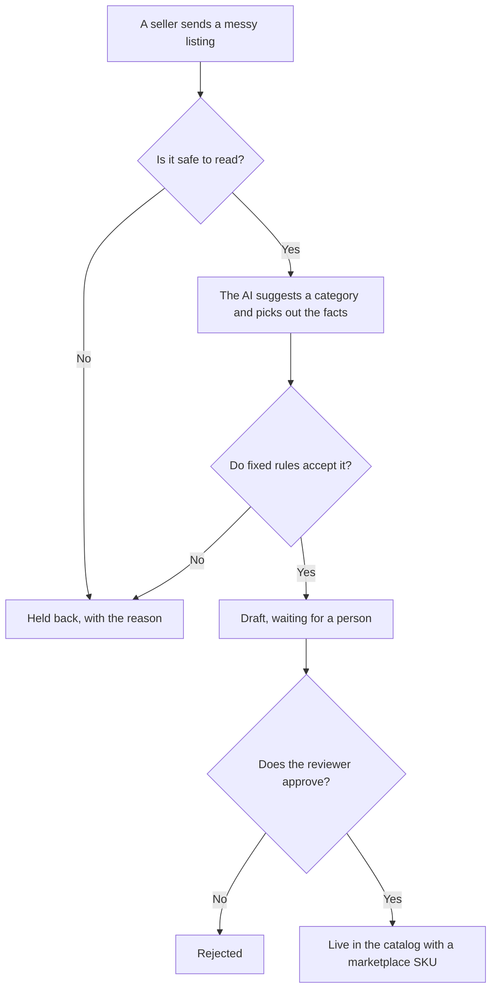
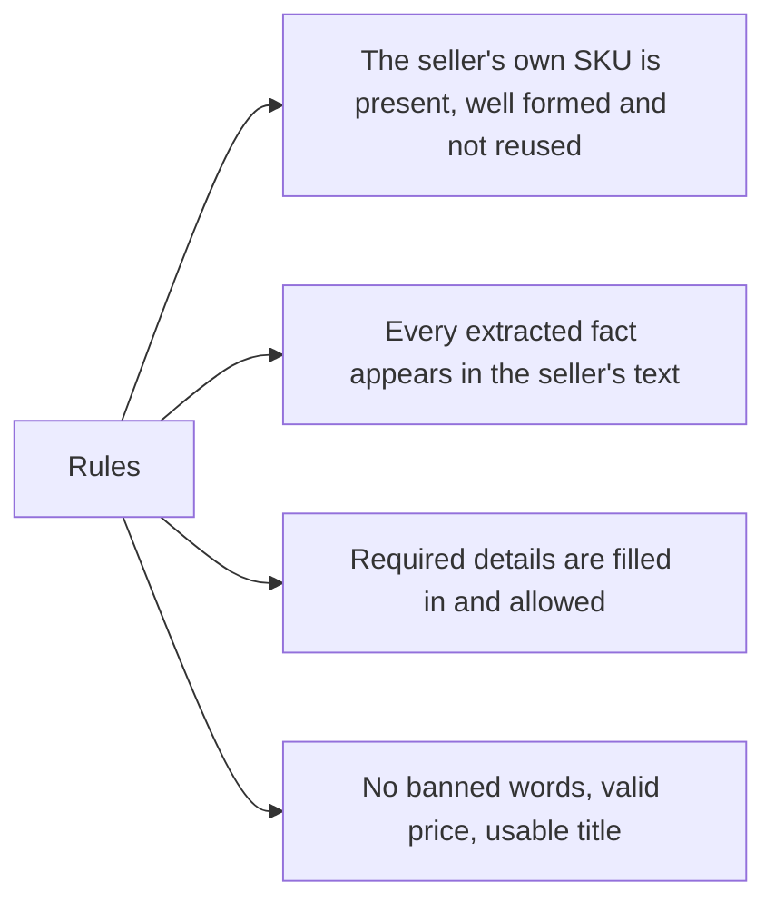

# How a listing moves through the engine (plain English)

All data is synthetic.

## From seller to shop shelf

## What the fixed rules check

## Who decides what
| Step | Decided by |
|---|---|
| Suggesting a category and reading facts | AI |
| Accepting or holding a listing | Fixed rules |
| Publishing and creating the marketplace SKU | A named reviewer |

A listing that is held back cannot be approved. The seller has to fix it and send it again.
